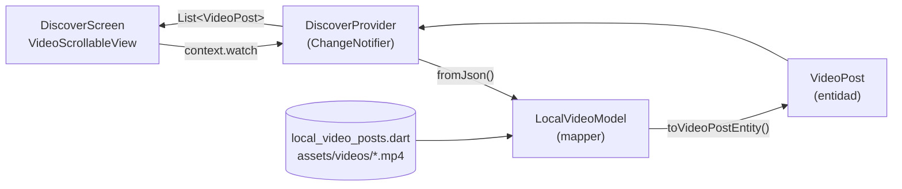

# Arquitectura de TokTik

La app sigue Clean Architecture con 4 capas:

| Capa | Carpeta | Contenido |
|------|---------|-----------|
| Config | `lib/config` | Temas por temporada (`SeasonTheme`, `AppTheme`), helpers, audio |
| Domain | `lib/domain` | Entidades (`VideoPost`, `Season`), contratos de datasources y repositories |
| Infrastructure | `lib/infrastructure` | Modelos/mappers, datasources (local, YouTube, Dailymotion, Vimeo, SharedPreferences) y repositories |
| Presentation | `lib/presentation` | Providers, pantallas y widgets |

## Diagrama 1 — Provider local (versión base)

El provider lee directamente los datos locales y los convierte con un mapper.

## Diagrama 2 — Provider a través de repositorio y datasources

Cada sección tiene su provider; el provider solo conoce el **contrato** del repositorio (dominio). Los datasources se inyectan en `main.dart`.

```mermaid
flowchart TB
    subgraph PRES["Presentation"]
        HS["HomeScreen<br/>PageView horizontal"]
        DS["DiscoverScreen"]
        FY["ForYouScreen"]
        FV["FavoritesScreen"]
        TB["HomeTopBar / SeasonSelectorSheet"]
        PD["DiscoverProvider"]
        PF["ForYouProvider"]
        PFV["FavoritesProvider<br/>(likes)"]
        PT["ThemeProvider"]
        PP["PlaybackProvider<br/>(mute)"]
        HS --> DS & FY & FV & TB
        DS --> PD
        FY --> PF
        FV --> PFV
        TB --> PT
    end

    subgraph DOM["Domain"]
        VR["«interface»<br/>VideoPostRepository"]
        LR["«interface»<br/>LikesRepository"]
        SR["«interface»<br/>SettingsRepository"]
        VDS["«interface»<br/>VideoPostDatasource"]
        LSD["«interface»<br/>LocalStorageDataSource"]
        ENT["VideoPost · Season · VideoSource"]
    end

    subgraph INF["Infrastructure"]
        DRI["VideoPostsRepositoryImpl"]
        FRI["ForYouRepositoryImpl<br/>(intercala fuentes)"]
        LRI["LikesRepositoryImpl"]
        SRI["SettingsRepositoryImpl"]
        LDS["LocalVideoPostDatasource"]
        YDS["YoutubeVideoPostDatasource"]
        DDS["DailymotionVideoPostDatasource"]
        VDS2["VimeoVideoPostDatasource"]
        PDS["PrefsLocalStorageDataSource"]
        MOD["Models / Mappers<br/>Local · YouTube · Dailymotion · Vimeo · Stored"]
    end

    PD --> VR
    PF --> VR
    PFV --> LR
    PT --> SR
    PP --> SR

    DRI -. implementa .-> VR
    FRI -. implementa .-> VR
    LRI -. implementa .-> LR
    SRI -. implementa .-> SR

    DRI --> LDS
    FRI --> YDS & DDS & VDS2
    LRI --> PDS
    LRI -->|"resolveStreamUrl()"| YDS & DDS & VDS2 & LDS
    SRI --> PDS

    LDS -. implementa .-> VDS
    YDS -. implementa .-> VDS
    DDS -. implementa .-> VDS
    VDS2 -. implementa .-> VDS
    PDS -. implementa .-> LSD

    LDS & YDS & DDS & VDS2 --> MOD --> ENT

    YDS --- YT[("YouTube<br/>youtube_explode_dart")]
    DDS --- DM[("Dailymotion<br/>API + player metadata")]
    VDS2 --- VM[("Vimeo<br/>player config")]
    PDS --- SP[("SharedPreferences<br/>likes · favoritos · tema · mute")]
```

## Flujo de un "me gusta"

1. `VideoButtons` llama `FavoritesProvider.toggleLike(video)`.
2. Se suma o resta 1 al contador y se actualiza la lista de favoritos en memoria (la UI cambia al instante).
3. `LikesRepositoryImpl.setLike` guarda en `SharedPreferences`: ids con like, contador por video (`like_count:<id>`) y el JSON del video para la sección Favorites.
4. Al reabrir la app, `FavoritesProvider.init()` recupera todo; los videos remotos refrescan su URL con `resolveStreamUrl`.
