# Práctica 05 — Widgets App

Aplicación móvil desarrollada con **Flutter** para practicar la construcción de
interfaces y el uso de widgets comunes. La aplicación reúne ejemplos interactivos
en un menú, utiliza **GoRouter** para la navegación y **Riverpod** para administrar
el estado de algunos componentes.

## Evidencias

Las capturas están organizadas en filas de tres:

<table>
  <tr>
    <td align="center">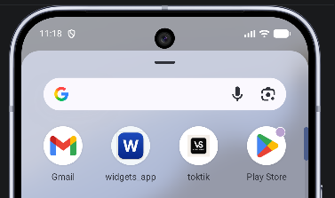<br>Icono de la aplicación</td>
    <td align="center">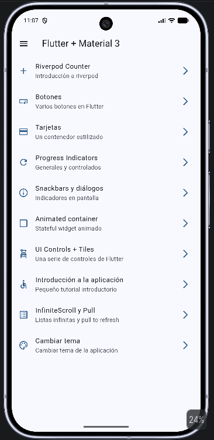<br>Inicio</td>
    <td align="center">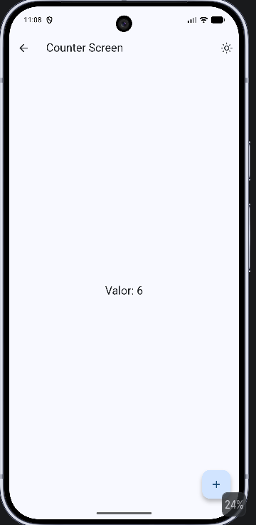<br>Counter Screen</td>
  </tr>
  <tr>
    <td align="center">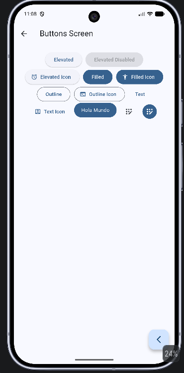<br>Buttons Screen</td>
    <td align="center">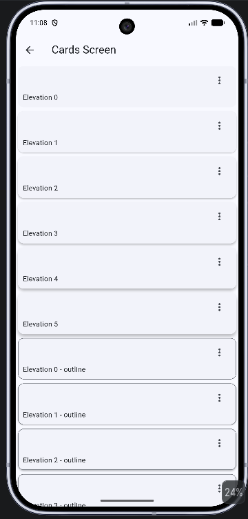<br>Cards Screen</td>
    <td align="center">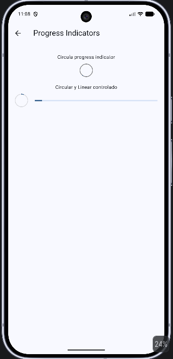<br>Progress Indicators</td>
  </tr>
  <tr>
    <td align="center">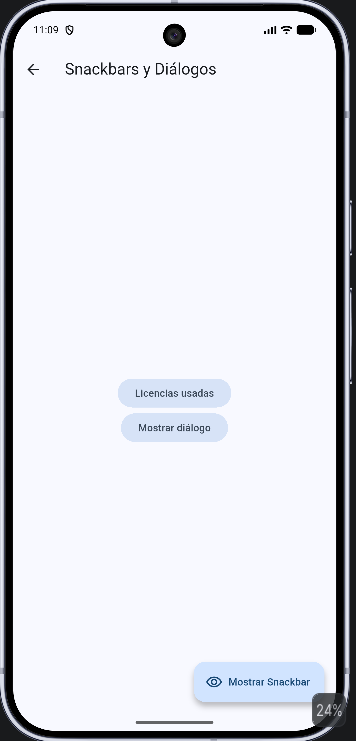<br>Snackbars y diálogos</td>
    <td align="center">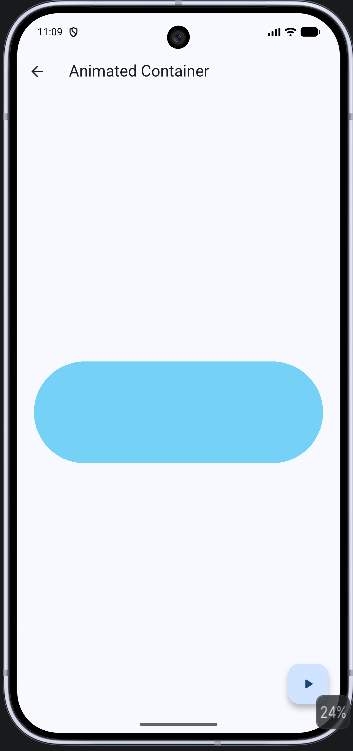<br>Animated container</td>
    <td align="center">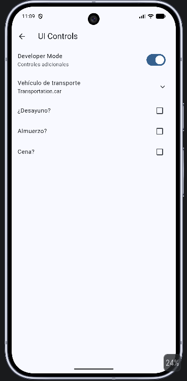<br>UI Controls</td>
  </tr>
  <tr>
    <td align="center">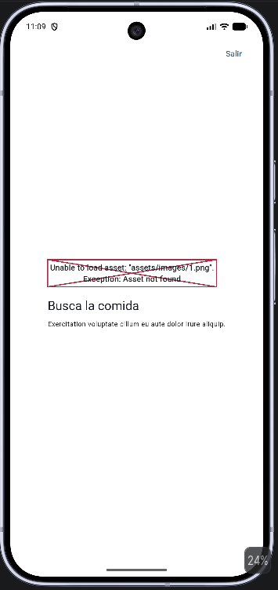<br>Introducción a la aplicación</td>
    <td align="center">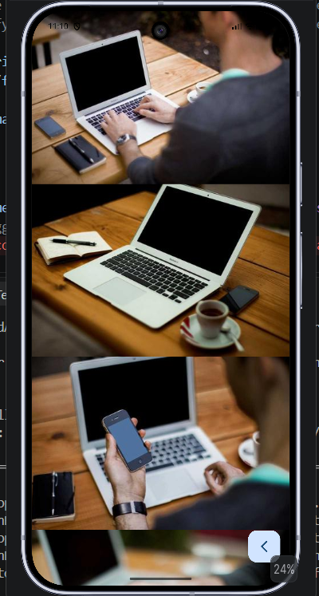<br>InfiniteScroll y Pull</td>
    <td align="center">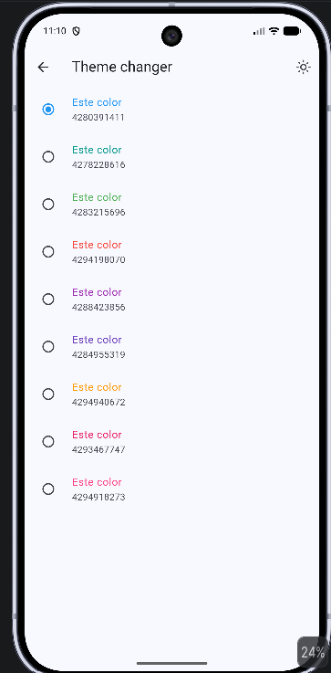<br>Cambiar tema</td>
  </tr>
</table>


### Diagramas publicados en GitHub Pages

- [ Abrir diagrama general](https://edwinhdzcm.github.io/Practicas_DMI_230425/Practica%2005/archify/practica05-widgets-20261028-232158/practica05-general.html)
- [ Abrir diagrama específico](https://edwinhdzcm.github.io/Practicas_DMI_230425/Practica%2005/archify/practica05-widgets-20261028-232158/practica05-especifico.html)


### Demo interactiva en Appetize.io

[▶️ **Abrir y probar Widgets App en Appetize.io**](https://appetize.io/app/b_lgfu2gqt3h5xiaqh4t2qwxqfqy)


## Objetivo

Explorar y construir interfaces con widgets de Flutter, practicar navegación entre
pantallas y observar cómo se actualiza el estado de la interfaz ante la interacción
del usuario.

## Funcionalidades

- **Menú principal:** acceso a los ejemplos desde una lista de opciones y un menú
  lateral.
- **Contador con Riverpod:** ejemplo de actualización de estado con un provider.
- **Botones y tarjetas:** muestras de componentes visuales de Material.
- **Indicadores de progreso:** ejemplos de indicadores generales y controlados.
- **Snackbars y diálogos:** presentación de mensajes y cuadros de diálogo.
- **Contenedor animado:** ejemplo de animación de un widget con estado.
- **Controles de interfaz:** interruptores, opciones de selección y casillas de
  verificación.
- **Tutorial introductorio:** recorrido inicial por la aplicación.
- **Desplazamiento infinito:** lista con carga adicional y gesto de actualización.
- **Cambio de tema:** selección de la apariencia de la aplicación.

## Tecnologías

- Flutter y Dart
- Riverpod (`flutter_riverpod`) para el estado
- GoRouter para la navegación
- `animate_do` para animaciones

Las pantallas se encuentran en `lib/presentation/screens/`; la configuración de
rutas, menú, tema y providers está en `lib/config/` y
`lib/presentation/providers/`.

## Requisitos y ejecución

Necesitas tener instalado Flutter y un emulador, dispositivo o navegador compatible.

```powershell
cd "Practica 05\widgets_app"
flutter pub get
flutter run
```
